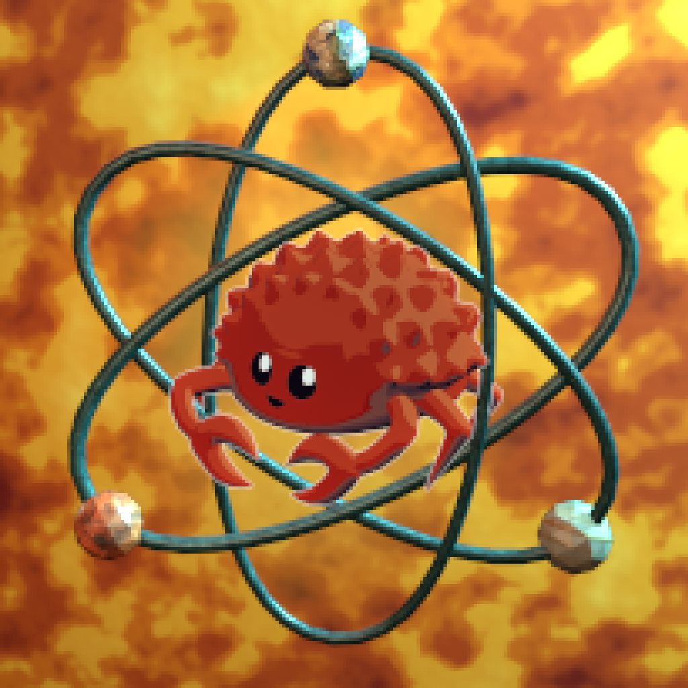

# ReFusion

<div align="center">
    
</div>

An in-process reimplementation of NynrahGhost's Fusion with faster merging, smaller output, compatibility validation, and full Unicode path support. Benchmarked around 4-11x faster, with an 82% smaller output pak.

## Mod users

Install it and launch the game normally. It works as a standalone replacement
or alongside the original Fusion dependency, which it safely takes over from.
Existing Fusion-based mods work without changes.

## Mod authors

Depend on ReFusion alone for new mods, or on both packages when supporting
existing dependency chains. It follows the same Fusion conventions.

Fusion mods are standard [pak patches](https://buckminsterfullerene02.github.io/dev-guide/Basis/PakPatching.html):
they provide cooked assets at the same relative paths as the game's assets, and
UE mounts them as replacements. You can use this to replace whole assets as
usual; ReFusion only merges datatables and inputs that follow the conventions
below. See Epic's [UE 4.27 patching guide](https://dev.epicgames.com/documentation/unreal-engine/how-to-create-a-patch-platform-agnostic?application_version=4.27)
for the underlying system.

For datatables, pack the `.uasset` and `.uexp` under:

```
<Project>/Content/Mods/<YourMod>/_Content/main/datatables/_<table>.*
```

Keep the leading `_` on the table name—for example, `_list_props.uasset` and
`_list_props.uexp`. Pack `DefaultInput.ini` normally for input merging.

## Credits

- **[NynrahGhost](https://github.com/NynrahGhost)** — Creator of the [OG Fusion](https://thunderstore.io/c/voices-of-the-void/p/NynrahGhost/Fusion/), which still works today.
    ReFusion wouldn't exist without it, and the original still remains an option.
- **Icon mesh** — [“Ferris the crab”](https://skfb.ly/ovyv9) by tuxlu, licensed
    under [CC BY 4.0](https://creativecommons.org/licenses/by/4.0/). Atom rings and background by me. 